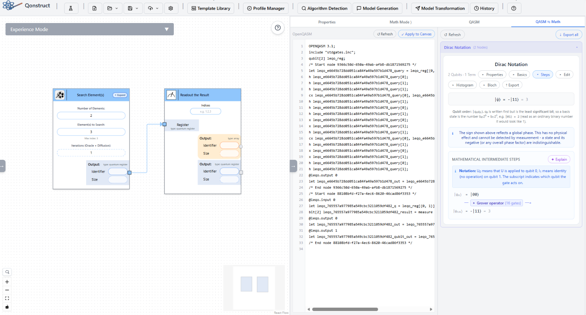
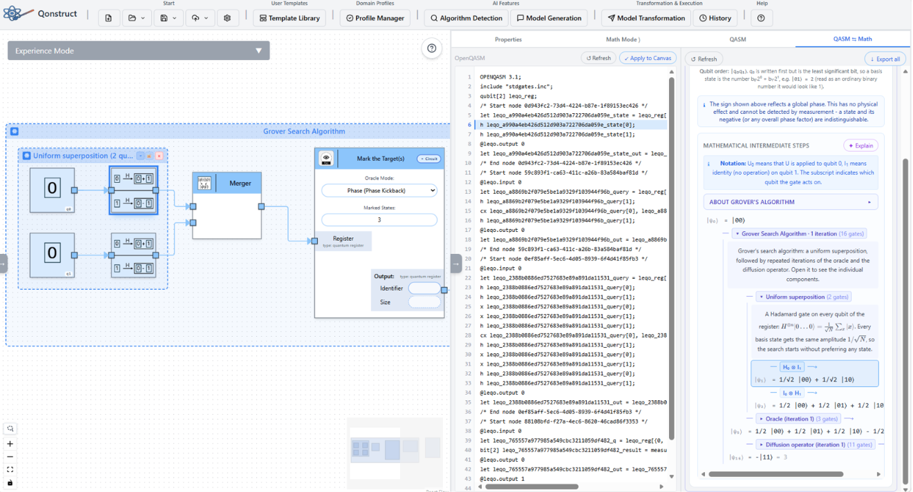
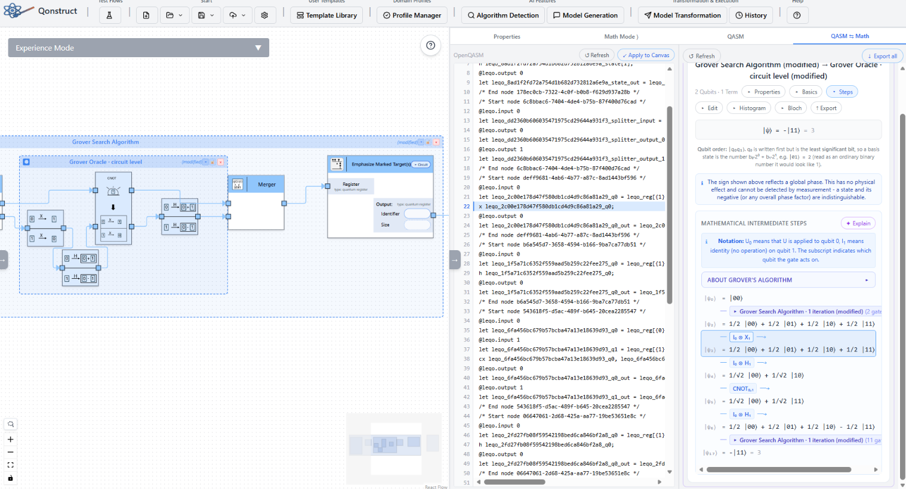
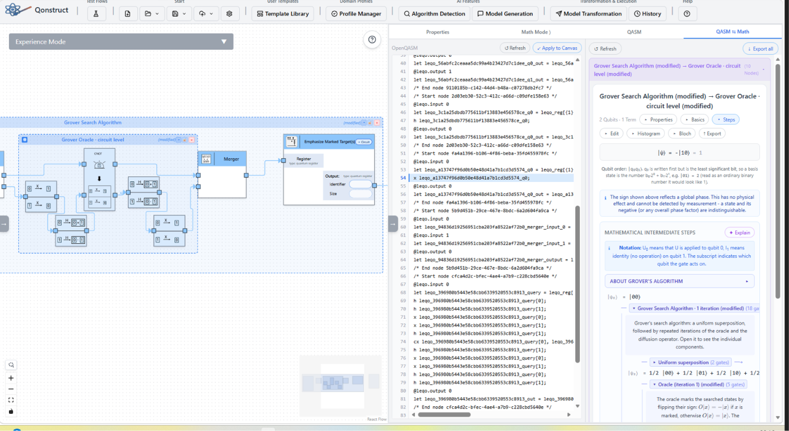

# Use Case: Fixing a Faulty Grover Oracle

This folder contains the use case of Section IV of the paper. A learner is given a Grover
building block that searches for |11⟩ on two qubits and is asked to change its oracle so that
it marks |10⟩ instead.

*The given model in all three views: the **Search Element(s)** block (2 elements, element 3 to
search, 1 iteration) followed by **Readout the Result** on the canvas, its generated OpenQASM
code, and its collapsed derivation |00⟩ →(Grover operator, 16 gates) −|11⟩ = 3.*

| File | Content |
| --- | --- |
| [`given_model.json`](given_model.json) | Given model: Grover block (2 qubits, marked state 3 = \|11⟩, 1 iteration) expanded into Prepare State, Oracle, and Diffuser, with the oracle expanded to its gates H₁ · CNOT₀,₁ · H₁ (i.e., CZ₀,₁), followed by a measurement |
| [`faulty_model.json`](faulty_model.json) | Model after the learner's first edit: X on q1 before the oracle's gates, second X missing |
| [`grover_use_case_model_correct.json`](grover_use_case_model_correct.json) | Model after the learner corrected the given model: oracle X₁ · H₁ · CNOT₀,₁ · H₁ · X₁ (i.e., X₁ · CZ₀,₁ · X₁), which marks \|10⟩ |
| [`images/`](images) | Screenshots of the steps below |

The qubits are written with q0 leftmost, i.e., |q0 q1⟩, but q0 is the least significant bit,
so the derivation view shows |11⟩ = 3 and |10⟩ = 1. The uniform superposition is
|s⟩ = ½(|00⟩ + |01⟩ + |10⟩ + |11⟩).

As soon as a building block is changed on the canvas, the modeler appends **(modified)** to its
label, both on the canvas (e.g., *Grover Search Algorithm (modified)* and *Grover Oracle ·
circuit level (modified)*) and in the corresponding steps of the derivation view (e.g.,
*Grover Search Algorithm · 1 iteration (modified)* and *Oracle (iteration 1) (modified)*). The
learner thus sees at a glance which parts deviate from the given building blocks.

## Steps

Start the environment as described in the [main README](../README.md#starting-the-environment)
and open the modeler at <http://localhost:4242>.

### 1. Load the given model

Click **Open New Diagram** in the toolbar and select [`given_model.json`](given_model.json).
The canvas shows the **Search Element(s)** block with 2 elements, the element 3 (|11⟩) to
search, and 1 iteration, followed by the **Readout the Result** block. The collapsed
derivation reads

|00⟩ →(Grover operator, 16 gates) −|11⟩ = 3,

i.e., |11⟩ up to a global phase.

### 2. Expand the Grover block and its oracle

Expand the Grover block into its parts **Uniform superposition** → **Mark the Target(s)** (the
oracle in phase-kickback mode, marked state 3) → **Diffusion operator**, and expand the oracle
down to its gates H₁ · CNOT₀,₁ · H₁, which together form a CZ gate. The derivation view is
structured like the model, so each part corresponds to one step that can be collapsed or
pulled down: *Uniform superposition (2 gates)*, *Oracle (iteration 1) (3 gates)*, and
*Diffusion operator (iteration 1) (11 gates)*.

Selecting a step in the derivation highlights the corresponding nodes on the canvas and the
corresponding lines in the code editor (linked navigation via the trace links τ). In the
screenshot below, the step H₀ ⊗ I₁ of the uniform superposition is selected, which highlights
the Hadamard gate on q0 on the canvas and the corresponding `h` instruction in the code:

### 3. Edit the oracle (with a mistake)

Insert an X gate on q1 before the oracle's gates, but do *not* insert the second X gate that
undoes the basis change. The resulting model is [`faulty_model.json`](faulty_model.json).
Since the oracle, and thus the Grover block containing it, now differ from the given building
blocks, both are labelled **(modified)** on the canvas and in the derivation view.

### 4. Notice that the edit seems to have no effect

The collapsed derivation still yields

|00⟩ →(Grover Search Algorithm · 1 iteration (modified)) −|11⟩ = 3,

i.e., *expected |10⟩, obtained |11⟩*.

*The faulty model: the oracle (Grover Oracle · circuit level (modified)) contains only the first
X gate on q1. The selected step I₀ ⊗ X₁ is highlighted together with the corresponding `x`
instruction in the code; the final state is still −|11⟩ = 3.*

### 5. Pull down the Grover step by one level

The derivation now reads

|00⟩ →(Uniform superposition) |s⟩ →(Oracle (iteration 1) (modified)) ½(|00⟩ + |01⟩ + |10⟩ − |11⟩)
→(Diffusion operator) −|11⟩.

The state after the superposition is as expected, and the diffusion operator only amplifies the
term that the oracle has marked. The deviation therefore originates in the oracle, which marks
|11⟩ instead of |10⟩.

### 6. Pull down the oracle step to its gates

|s⟩ →(I₀ ⊗ X₁) |s⟩ →(I₀ ⊗ H₁) 1/√2 (|00⟩ + |10⟩) →(CNOT₀,₁) 1/√2 (|00⟩ + |11⟩)
→(I₀ ⊗ H₁) ½(|00⟩ + |01⟩ + |10⟩ − |11⟩).

The X step leaves the uniform superposition unchanged, and the H · CNOT · H steps (i.e., CZ)
mark |11⟩. Since the second X gate is missing, the basis change is not undone. Selecting a step
highlights the corresponding gate on the canvas and the corresponding lines in the code editor.

### 7. Fix the oracle

Insert I₀ ⊗ X₁ after the oracle's last H gate. The model is updated, and the derivation is
recomputed. The resulting model is
[`grover_use_case_model_correct.json`](grover_use_case_model_correct.json). The oracle now
consists of X₁ · CZ₀,₁ · X₁ (*Oracle (iteration 1) (modified) (5 gates)*) and yields

|s⟩ →(Oracle) ½(|00⟩ + |01⟩ − |10⟩ + |11⟩),

so the algorithm yields |ψ⟩ = −|10⟩ = 1, i.e., |10⟩ up to a global phase. The oracle and the
Grover block remain labelled **(modified)**, since they still differ from the given building
blocks.

*The corrected model: the oracle (Grover Oracle · circuit level (modified)) applies the X gate
on q1 before and after H · CNOT · H. The derivation of Grover Search Algorithm · 1 iteration
(modified) (18 gates) yields −|10⟩ = 1.*

## Expected States

The states below are computed by the simulator of the modeler (up to a global phase):

| Model | After the oracle | Final state |
| --- | --- | --- |
| Given (`given_model.json`) | ½(\|00⟩ + \|01⟩ + \|10⟩ − \|11⟩) | \|11⟩ |
| Faulty (`faulty_model.json`) | ½(\|00⟩ + \|01⟩ + \|10⟩ − \|11⟩) | \|11⟩ |
| Corrected (`grover_use_case_model_correct.json`) | ½(\|00⟩ + \|01⟩ − \|10⟩ + \|11⟩) | \|10⟩ |
